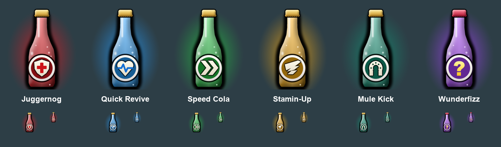
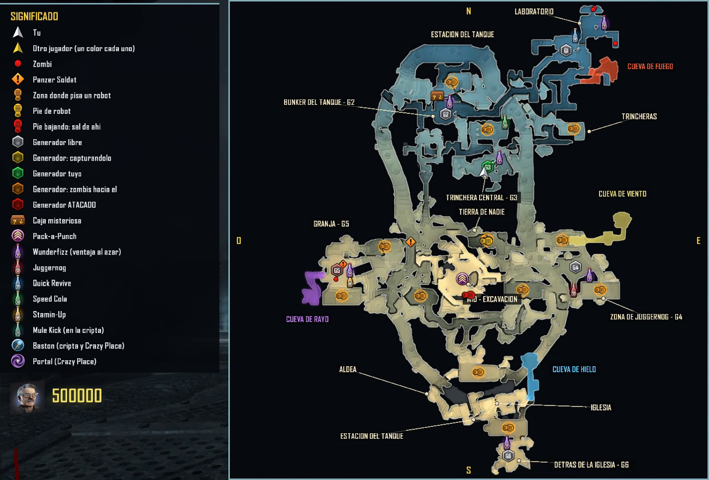
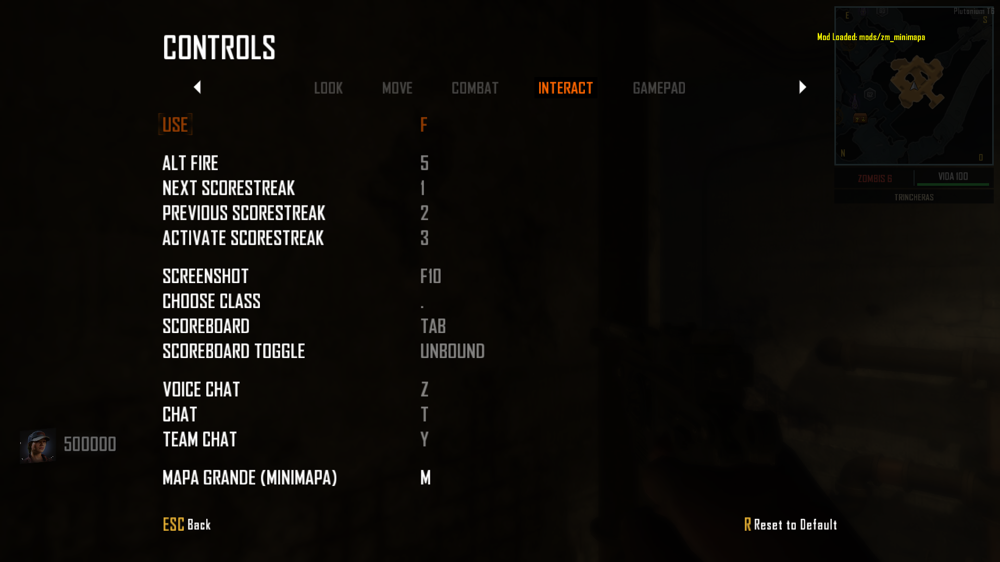

# BO2 Origins Minimap

Minimapa para **Origins** (Black Ops 2 Zombies) en Plutonium T6. Te sigue, gira contigo y muestra el relieve del mapa.

> Probado en solitario. El cooperativo está sin comprobar.


## Qué hace

- Minimapa con zoom, giro y puntos cardinales
- Zombis (con marca si están arriba o abajo), Panzer Soldat, compañeros y pies de los robots gigantes
- Generadores G1–G6 con su estado: libre, capturando, tuyo, en peligro o atacado
- Ventajas, Wunderfizz, caja y Pack-a-Punch
- Ilumina la cueva o estructura en la que estás, la cripta y Crazy Place
- Zombis restantes, vida y nombre del lugar
- Mapa grande con leyenda (tecla **M**, se cambia en Controles)






*Sólo el mapa grande y la pantalla de controles son capturas del juego; las demás imágenes son simulaciones.*

## Instalación

**Necesitas:** Black Ops 2 funcionando en [Plutonium](https://plutonium.pw) (T6) y el mapa Origins.

### 1. Descarga

Entra a [**Releases**](https://github.com/FrankPater15/BO2-Origins-Minimap/releases), abre la versión que quieras y descarga el archivo `BO2-Origins-Minimap-vX.zip`.

> No uses el botón verde **Code** ni los archivos *Source code*: traen también archivos de desarrollo.

### 2. Copia las dos carpetas

1. Cierra el juego.
2. Pulsa **Windows + R**, pega esto y dale a Enter:
   ```
   %localappdata%\Plutonium\storage	6
   ```
3. Si ya hay una carpeta `images`, guarda una copia en otro sitio.
4. Abre el zip y copia **`mods`** e **`images`** dentro de `t6`. Si Windows pregunta, acepta combinar y reemplazar.

Van **las dos en `t6`**; no metas `images` dentro de `mods`. Debe quedar así:

```
Plutonium\storage	6
├── images
│   ├── hud_zombierank_5.iwi
│   └── ... (19 archivos del mod)
└── mods
    └── zm_minimapa
        ├── mod.iwd
        ├── mod.json
        └── ...
```

### 3. Actívalo

1. Abre Plutonium y entra a **Zombies**.
2. En el menú, abre la consola: la tecla a la izquierda del **1** (`~`, `º` o `|`).
3. Escribe `loadmod zm_minimapa` y pulsa Enter.
4. Juega **Origins**, solo o como anfitrión. El minimapa sale arriba a la derecha y **M** abre el mapa grande.

Si al volver a abrir el juego no aparece, repite `loadmod zm_minimapa`.

## Cambiar la tecla del mapa grande

Dentro de una partida en Origins: **Esc → Options → Controls → Interact → MAPA GRANDE (MINIMAPA)**. Haz clic, o usa las flechas izquierda y derecha, hasta la tecla que quieras. Se guarda sola y no ofrece teclas que ya uses para otra acción.



La opción no sale en el menú principal. Teclas disponibles: M, N, B, H, J, K, L, U, I, O, P, X, F6, F7 y F8.

<details>
<summary>En la v0.25.0 o anteriores</summary>

No existe esa opción. Escribe en la consola `bind M "toggle mm_big 0 1"`; cambia la `M` por otra tecla si quieres.
</details>

## Problemas comunes

| Problema | Solución |
|---|---|
| `loadmod` no encuentra el mod | Comprueba que exista `t6\mods\zm_minimapa\mod.iwd`, sin carpetas de más en medio. |
| No sale el minimapa | Repite `loadmod zm_minimapa` en el menú y escribe `set minimapa_lui 1`. Sólo funciona en Origins y para el anfitrión. |
| Mapa en blanco o iconos raros | Falta copiar `images` en `t6\images`. |
| M no abre el mapa | Revisa la tecla en Controles. Si M ya era de otra acción, el mod eligió la siguiente libre. |
| El mapa tiembla al girar | Prueba `set mm_giro 0`, `1`, `2` o `3`. |
| Cambiaron tus controles | Plutonium usa controles aparte con un mod cargado; ajústalos una vez. |

## Consola

| Comando | Efecto |
|---|---|
| `set minimapa_lui 0` / `1` | Oculta / muestra el minimapa |
| `set mm_zoom 1000` | Zoom, de 700 (cerca) a 2500 (lejos); normal 1750 |
| `set mm_big 1` / `0` | Abre / cierra el mapa grande |
| `set mm_giro 0` / `1` / `2` / `3` | Modo de giro, si el mapa tiembla al mover la cámara |

## Limitaciones

- En cooperativo sólo lo ve el anfitrión.
- Reemplaza, mientras estén instaladas, imágenes del juego que no se usan en partida: las 19 de la carpeta `images` de este repositorio. Pueden verse cambiadas en el menú o el lobby: por ejemplo, los deslizadores de Opciones salen con dibujos de portales.
- Plutonium usa controles y algunas estadísticas aparte con un mod cargado.

## Desinstalar

Borra `mods\zm_minimapa` y, de `images`, los archivos que tienen el mismo nombre que los de este repositorio. Restaura tu copia si la hiciste.

## Aviso

Proyecto de fans, gratuito y no oficial, sin relación con Activision, Treyarch ni Plutonium. Call of Duty y sus contenidos pertenecen a sus dueños. El trazado se basa en la geometría de Origins; los iconos son dibujos propios.

## Licencia

[PolyForm Noncommercial 1.0.0](LICENSE) para el código y los iconos propios: puedes usarlo, modificarlo y compartirlo gratis dando crédito, pero **no venderlo ni usarlo con fines comerciales**.

No cubre Call of Duty ni el diseño del mapa Origins, que pertenecen a sus dueños.
