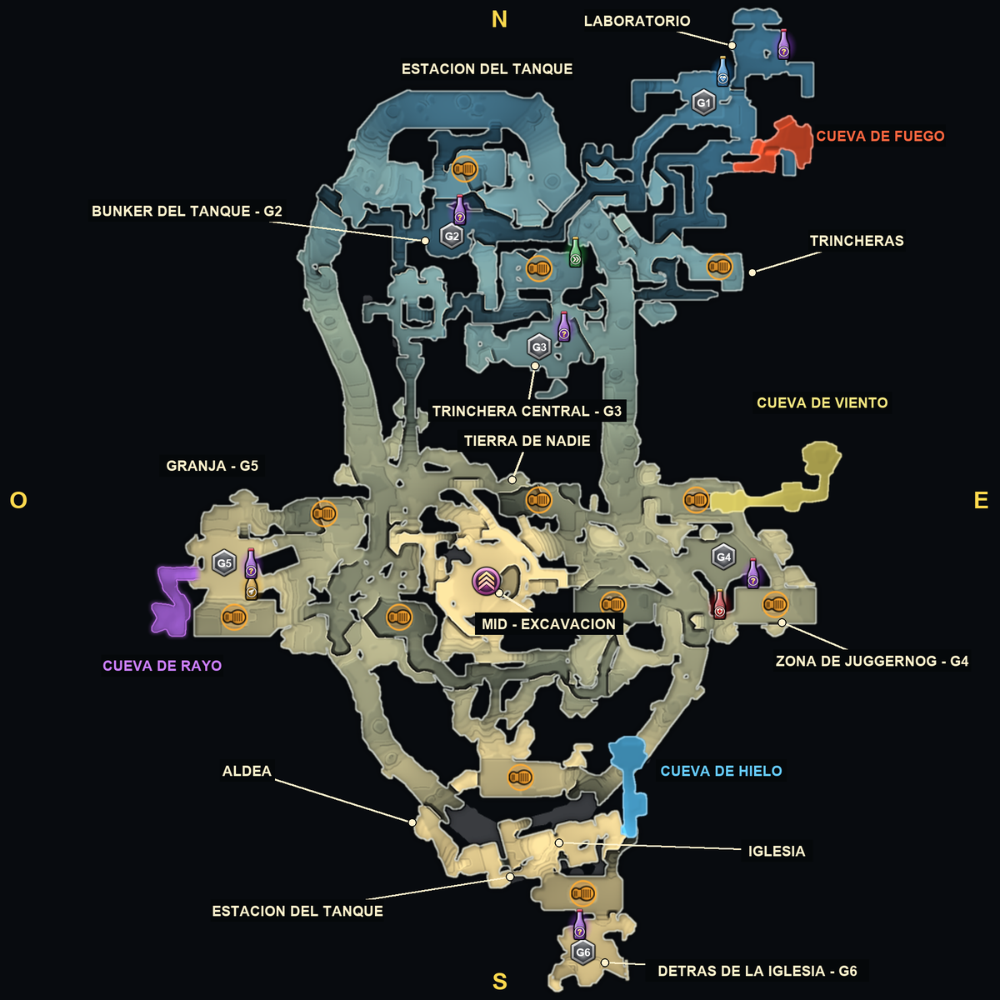
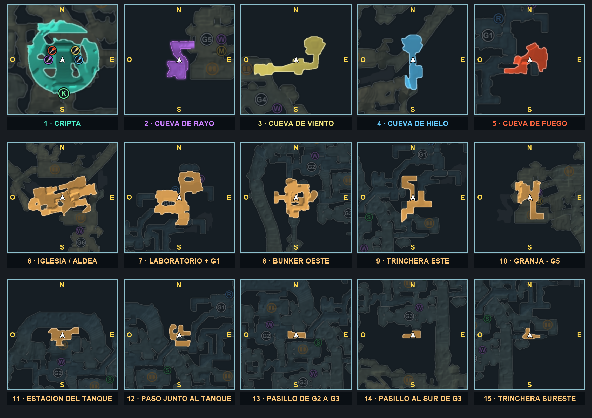

# BO2 Origins Minimap

Minimapa para **Origins** (Black Ops 2 Zombies) en Plutonium T6. Te sigue, gira contigo y muestra el relieve del mapa.

> **En desarrollo.** Las últimas funciones (mapa grande, leyenda, relieve y estructuras iluminadas) aún no están probadas en el juego.

## Qué hace

- Minimapa con zoom, giro y puntos cardinales
- Zombis (con marca si están arriba o abajo), Panzer Soldat, compañeros y pies de los robots gigantes
- Generadores G1–G6, ventajas, Wunderfizz, caja y Pack-a-Punch
- Ilumina la cueva o estructura en la que estás, la cripta y Crazy Place
- Zombis restantes, vida y nombre del lugar
- Mapa grande con leyenda (tecla **M**)

*Las imágenes son simulaciones, no capturas del juego.*

## Instalación

1. Abre `%localappdata%\Plutonium\storage\t6`
2. Haz una copia de tu carpeta `images`, si tienes una.
3. Copia `mods` e `images` de este repositorio ahí dentro.
4. Abre Plutonium y, en el menú de Zombies, escribe en la consola: `loadmod zm_minimapa`
5. Asigna la tecla del mapa grande: `bind M "toggle mm_big 0 1"`
6. Entra a Origins en solitario o como anfitrión.

## Consola

| Comando | Efecto |
|---|---|
| `set minimapa_lui 0` / `1` | Oculta / muestra el minimapa |
| `set mm_zoom 1000` | Zoom, de 700 (cerca) a 2500 (lejos); normal 1750 |
| `set mm_big 1` / `0` | Abre / cierra el mapa grande |
| `set mm_giro 0` / `1` / `2` / `3` | Modo de giro, si el mapa tiembla al mover la cámara |

## Limitaciones

- En cooperativo sólo lo ve el anfitrión.
- Reemplaza estas imágenes del juego mientras estén instaladas: `icon_twitter`, `icon_facebook`, `hud_zombierank_5`, y `hud_zombierank_3_ded` a `hud_zombierank_5_ded`.
- Plutonium usa controles y algunas estadísticas aparte con un mod cargado.

## Desinstalar

Borra `mods\zm_minimapa` y, de `images`, los archivos que tienen el mismo nombre que los de este repositorio. Restaura tu copia si la hiciste.

## Aviso

Proyecto de fans, gratuito y no oficial, sin relación con Activision, Treyarch ni Plutonium. Call of Duty y sus contenidos pertenecen a sus dueños. El trazado se basa en la geometría de Origins; los iconos de las ventajas los carga el juego y no se incluyen aquí.
